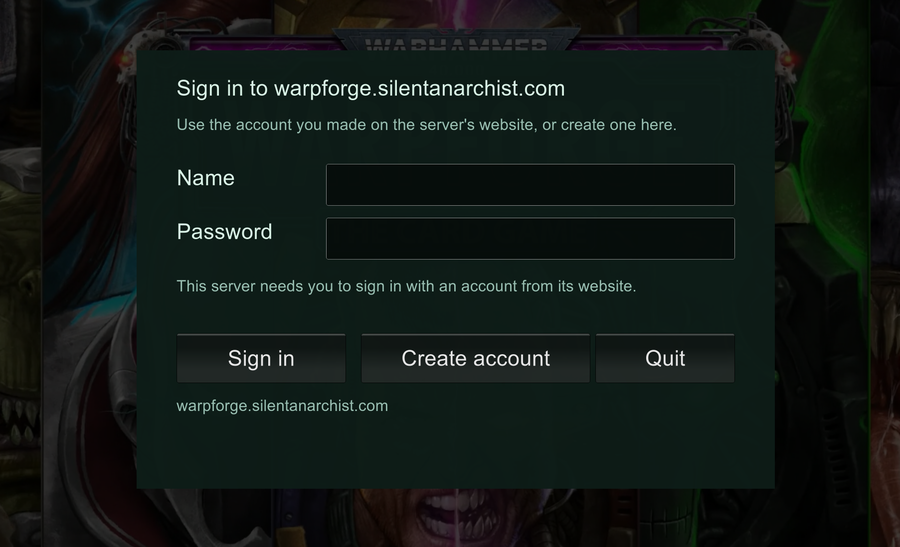

# Warpforge Revival for Android

*This guide was the README of the separate Android repository
([warpforge-revival-mod-android](https://github.com/silentanarchist/warpforge-revival-mod-android)) until both mods moved
into this one repository on 2026-10-17. The mod and the Warpforge Patcher app are released from this repository's
[releases page](https://github.com/silentanarchist/warpforge-revival-mod/releases) now; the old repository stays up so
older copies of the app can still find their update.*

Everything needed to run *Warhammer 40,000: Warpforge* on an Android phone against a
[Warpforge Revival server](https://github.com/silentanarchist/warpforge-revival-server), now that
the game's own servers are closed:

- **the Android build of the Warpforge Revival mod** (`WarpforgeRevival.Android.dll`),
- **the patcher** that puts a mod loader into your own copy of the Android game, and
- **the changes made to that mod loader** so it runs this game on current phones.

The Windows mod is in this same repository ([README](../README.md)).
Both are built from the same source and numbered `x.y.z.f-a` for Android and `x.y.z.f-w` for
Windows: `x.y.z` is the shared code and always the same on both; `f` counts fixes made for one of
them only, is left off while it is 0 (`0.12.3-a`), and starts again with every new `x.y.z`.

This is an unofficial fan project. It is not affiliated with or endorsed by Everguild or Games
Workshop. It contains no game files: you need your own copy of the game.

**About AI use.** The mod, the changes to the mod loader and patcher, the scripts and this
documentation were written largely by an AI assistant (Anthropic's Claude), working under the
maintainer's direction; the maintainer decided what to build and tested it on real phones. The
loader changes touch low-level code and have been tried on only a few devices, so expect rough
edges. Read the code before you rely on it, and please report what you find.

> **Status: works on one phone.**
> The whole chain below has been run on a Pixel 8 Pro on Android 17: the game starts, signs in,
> plays matches and updates its mod from the server. Other phones and Android versions are
> untested; if it fails on yours, the logs (see [If something goes wrong](#if-something-goes-wrong))
> are what is needed to find out why. 

## Easiest: patch on the phone with the Warpforge Patcher app

The **Warpforge Patcher** app does everything the PC scripts below do, on the phone itself: it patches your own copy of the game, installs it and puts the mod in place. No PC patching, no cable, no adb. It uses the same patching code as `patcher\1 - patch.bat`. Its source is the `WarpforgePatcher` folder of [this project's LemonLoader installer fork](https://github.com/silentanarchist/MelonLoaderInstaller/tree/warpforge-revival/WarpforgePatcher) (GPL-3.0).

1. Download `WarpforgePatcher-<version>.apk` from the **Warpforge Patcher** release on the [releases page](https://github.com/silentanarchist/warpforge-revival-mod/releases) and open it on the phone. Allow installing apps from your browser when Android asks.
2. Open **Warpforge Patcher** and allow the two permissions it asks for: all files access (for the loader's folder) and installing apps.
3. Press **Patch and install** (or **Patch from a backup file** for a `.apks` / `.xapk` backup). Confirm Android's prompts (removing the old game if the app has to, then installing the patched one). The data file takes a few minutes.
4. Start the game, allow "All files access" if it asks, and sign in.

**The two main buttons**
- **Patch and install** (**Patch again and install** once the game is patched): puts the mod loader into the game on this phone, installs the patched game and puts the current mod in place. Use it the first time, and again whenever a new loader comes out. Patched by this app before, it installs over the game and keeps everything.
- **Update the mod only**: downloads the current mod from the server and puts it in place, without touching the game. Use it when the game stops at the title screen with a connection error, or to get a new mod straight away. The mod also updates itself when the game starts.

**Fix black menu after loading** (ticked by default on Pixel 6 and later, and on Samsungs with an Exynos chip and Mali graphics) shows a still picture on the loading screen instead of the opening video, which can leave the menu black on those phones.

**Keep the app's signing key.** **Save a copy of the signing key** in the app and keep the file private. Later patches must use the same key, or the game has to be removed again. A game patched on a PC carries a different key, so moving between PC- and phone-patched needs one removal.

Something wrong? **Share logs** in the app makes one zip with the app's log, `Latest.log` and the mod's settings (never the game login).

The rest of this page is the PC route: the scripts in `patcher/`, run from a Windows PC with a cable.

---

## Before you start

Read this part first.

**What you need**

- A Windows PC and a USB cable.
- An Android phone with a 64-bit ARM processor (every current phone). Tested on Android 17 only.
- Your own copy of the Android game, version **1.35.0**: a backup of the app you made from your
  own phone. A backup app saves it as one file of about 780 MB, usually named something like
  `Warhammer 40,000 Warpforge_1.35.0.apks` (or `.xapk`). Whatever the name, make sure the
  version in it is 1.35.0: other versions will not work. Inside are the game's three parts:
  `com.Everguild.WarhammerWarpforge.apk`, `config.arm64_v8a.apk` and `UnityDataAssetPack.apk`.
- About 3 GB of free disk space on the PC, and about 2 GB free on the phone.
- Google's "SDK Platform-Tools for Windows" (the `adb` program), from
  <https://developer.android.com/tools/releases/platform-tools>.

**Do not uninstall the game yourself until the patch is done.**
The original game has to come off the phone at some point, but only at the very end: after you have
made your backup of the app (the `.apks` / `.xapk` file, above), after `1 - patch.bat` has unpacked that backup and finished, and after you have
checked that the `patched` folder holds its three files. Uninstalling earlier can leave you with
no copy of the game to patch. With a cable, `2 - install on phone.bat` does the removal for you at
the right moment (step 6). Without one, see step 6 as well.

**Keep your signing key.**
The first time you patch, the patcher makes a signing key and saves it as
`patcher\tool\signing-key.pem`. Every later patch you install has to be signed with that same
key, or Android refuses it and you are back to removing the game. Keep the file, keep it private,
and never share a patcher folder that has it inside.

---

## Step by step

### 1. Get the patcher

Download [this repository](https://github.com/silentanarchist/warpforge-revival-mod) (green **Code** button, then **Download ZIP**) and unzip it somewhere
with a short path, for example `C:\warpforge-android`. Everything you run is in the `patcher`
folder.

### 2. Put your game files in

Do one of these:

- put your backup file (`.apks` or `.xapk`) straight into the `patcher` folder, **or**
- put its three `.apk` files into `patcher\game-files`.

### 3. Nothing to do: the loader package is downloaded for you

The loader itself (`melon_data.zip`, in three pieces) and the patching program (`LemonPatch.exe`,
in two halves) are about 84 MB, so they are not stored in this repository. The first time
`1 - patch.bat` runs, `patcher\tool\get-tools.ps1` downloads the five pieces into `patcher\tool`
from the commit of the old Android repository where they were published, checks each against its
SHA-256, and `1 - patch.bat` joins them. Without internet, download them yourself from
[that commit](https://github.com/silentanarchist/warpforge-revival-mod-android/tree/52b333dd265cbee4471db22bfe140d95e99754c5/patcher/tool)
into `patcher\tool`. It is built for **game version 1.35.0** only; see
[The loader package](#the-loader-package) for what is inside.

### 4. Patch

Double-click **`1 - patch.bat`**. It:

1. downloads the patching program and the loader package if they are not there yet, and joins them from their pieces,
2. unpacks your backup file if you gave it one,
3. puts the mod loader into the game and signs the result.

The big data file takes a few minutes. When it finishes, the `patched` folder holds three files:

```
base.apk   config.arm64_v8a.apk   UnityDataAssetPack.apk
```

All three belong together. If it stops with an error, the details are in `patcher\patch-log.txt`.

### 5. Switch on USB debugging on the phone

1. Settings > About phone > tap **Build number** seven times. This unlocks "Developer options".
2. Settings > System > Developer options > switch on **USB debugging**.
3. Connect the phone to the PC by cable. The phone asks "Allow USB debugging?" - accept it.

Unzip Google's platform-tools so that this file exists:

```
patcher\tool\platform-tools\adb.exe
```

### 6. Install on the phone

Double-click **`2 - install on phone.bat`**.

- If the game on the phone was patched before with the same signing key, the new copy installs
  over it and nothing is lost.
- Otherwise the install is refused, and the script asks whether to remove the copy on the phone
  first. That removes the game's downloaded files too; the server hands them out again. It only
  goes ahead if you type `YES`.

No cable? Copy the three files from `patched` to the phone and install them *together* with a
split-APK installer app such as SAI. Tapping `base.apk` on its own does not work. Android refuses
the install while the original game is still on the phone, so uninstall it yourself (hold the
game's icon > **Uninstall**) **only now**: after your backup of the app is on the PC, `1 - patch.bat` has
finished and the three files are on the phone. Then install them.

### 7. First start

Start the game once.

- If it asks for **"All files access"**, allow it. The loader keeps its files, its logs and the
  `Mods` folder in `MelonLoader/com.Everguild.WarhammerWarpforge/` on the phone's storage.
- The very first start after an install copies the loader's files and sits on a black screen for
  up to a minute. Later starts skip that.
- Without the mod the game stops at the title screen with a connection error. That is expected.

Close the game (swipe it away from the recent apps).

### 8. Put the mod on the phone

Download the latest Android mod (`WarpforgeRevival.Android-<version>.zip`) from [Releases](https://github.com/silentanarchist/warpforge-revival-mod/releases) (or from `releases/` here) and unzip it.

- Copy `WarpforgeRevival.Android.dll` into `patcher\mods` and double-click
  **`3 - put mod on phone.bat`**, **or**
- copy the file on the phone itself into `MelonLoader/com.Everguild.WarhammerWarpforge/Mods/`.

### 9. Play

Start the game. It reaches the menu in about half a minute.

- If the server asks for an account, a sign-in window appears while the game loads - see
  **Signing in and making an account** just below.
- Or download a **game login file** from the website's profile page and copy it over with
  **`4 - put game login on phone.bat`** (it finds the file in your Downloads folder).
- Servers that do not ask for an account sign the phone in with its device id.
- To play as someone else on the phone, use **Sign out** in **Settings > Account**. It signs out
  this phone only; the account keeps its progress.
- Forgotten password: make a **recovery code** on the website's profile page while you still know
  it and keep the file; **Forgot your password?** on the website's sign-in page uses it.

#### Signing in and making an account

When the server needs an account, this window appears while the game loads:



**New player? Make your account right here - there is no separate form.**

1. In **Name**, type the name you want (5 to 30 letters, digits, `.` `'` `-` or `_`, no spaces).
2. In **Password**, type the password you want (at least 6 characters, no spaces; do not reuse one
   from another site).
3. Press **Create account**. The account is made with what you typed and the game signs in.

Pressing **Create account** with the boxes empty only says "Enter a name and a password." - fill
them in first, then press it.

**Already have an account** (made here or on the server's website)? Type its name and password
and press **Sign in**. The game remembers the sign-in, so it asks only once on each computer or
phone. The same account works everywhere and keeps the same decks and progress.

Afterwards, on the server's website (its profile page) you can make a **recovery code** in case you
forget your password. **Sign out** in **Settings > Account** signs out this device only.

The mod's version is shown next to the game's in **Settings > General**.

To use a different server, edit `ServerUrl` in
`MelonLoader/com.Everguild.WarhammerWarpforge/UserData/WarpforgeRevival.cfg` on the phone.

---

## Updates

**The mod updates itself.** When the server has a newer build, the sign-in window says so while
the game loads, downloads it, checks it and puts it in place, then closes the game after a few
seconds. Open the game again and it runs the new version. (`AutoUpdate = Off` in
`WarpforgeRevival.cfg` switches this off.)

**The loader does not.** A new loader means running `1 - patch.bat` and `2 - install on phone.bat`
again. With the same signing key that installs over the old copy and keeps everything.

## Removing it from a phone

Double-click **`5 - uninstall from phone.bat`** with the phone connected. It asks you to type `YES`,
copies the phone's settings file and logs to `patcher\uninstall-backup`, then removes the game, the
loader and the mod, and the saved sign-in. Your account, decks and progress are on the server and
stay there. Without a PC: hold the game's icon > **Uninstall**, then delete the folder
`MelonLoader/com.Everguild.WarhammerWarpforge` with a file manager.

---

## If something goes wrong

**Collect the logs.** Connect the phone and double-click **`0 - get phone logs.bat`**. It asks:

- `1` - the game is closed and you are about to start it. It clears the phone's system log, then
  waits while you start the game and reproduce the problem.
- `2` - the game is open and something just went wrong. It saves the logs as they are now. Use
  this one *before* force-stopping the app, or the evidence is gone.

It makes a new folder under `patcher\phone-logs`. That folder is what to send. The logs can
contain your player id and server address, so do not post them publicly.

**Things seen so far**

| What happens | What to do |
|---|---|
| The install is refused | The copy on the phone was signed with a different key. See step 6. |
| Black screen for up to a minute on the first start after installing | Wait. It is copying the loader's files; later starts skip it. |
| The game stops at the title screen with a connection error | The mod is not on the phone (step 8), or the server is not reachable from the phone. |
| The game closes a few seconds after you open it, right after an update | An older mod build's "Close game" left the app half-closed. Swipe it away from the recent apps and open it again. Fixed from 0.11.9-a. |
| After the opening video the screen stays black while the music plays (seen on a Pixel 6 Pro, about 1 start in 5) | The mod notices and brings the picture back by itself within a second or two. To stop it happening: the phone's hardware video decoder is the cause, so run **`6 - fix loading video.bat`** (option `1`) and then **`7 - loading video setting.bat`** (option `1`, Still). No video is decoded and the opening clip's last frame is shown as a picture for the whole load. |
| The opening video is blocky, discoloured or stutters (seen on a Pixel 6 Pro) | The phone's H.264 decoder does a poor job of it. Run **`6 - fix loading video.bat`** (option `1`) with the phone connected: it needs ffmpeg (the script says where to get it), copies the opening video out of your game file, converts it to WebM and puts it on the phone, where the mod plays that copy instead. Looks only. Option `2` removes it again. |
| The screen goes black during a match | Switch on the game's own **Settings > Graphics > Extended compatibility**, then restart the game. |
| The game closes by itself while loading | The mod loader crashed. It closes the game within a few seconds and leaves a crash report; open the game again. If it happens more than now and then, collect logs with option `1` and send them. |
| A start gets stuck before signing in, or closes within seconds, for no clear reason | Swipe the app away and start again. If it keeps happening, collect logs with option `2` before closing it. |

---

## For server owners

A server needs two things for phones, both described in the
[server's README](https://github.com/silentanarchist/warpforge-revival-server):

- the Android build of the game's content files in `content/bundles-android/` (the content files
  differ per platform; the Windows ones do not load on a phone), and
- the Android mod as `mod/WarpforgeRevival.Android.dll`, so phones are offered updates.

---

## What is in this repository

| Path | What it is |
|---|---|
| `WarpforgeRevival/` | The mod's source. The same files build the Windows mod; the parts marked `ANDROID_PORT` are the Android differences. |
| `WarpforgeRevival.Android/` | The project that builds `WarpforgeRevival.Android.dll` from that source. |
| `releases/` | Built mods, Windows and Android. Each zip committed here is also published under Releases. |
| `patcher/0 - get phone logs.bat` | Collects the phone's logs when something goes wrong (can be used at any point). |
| `patcher/1 - patch.bat` | Patches your copy of the game. |
| `patcher/2 - install on phone.bat` | Installs the patched game over USB. |
| `patcher/3 - put mod on phone.bat` | Copies the mod from `patcher\mods` to the phone. |
| `patcher/4 - put game login on phone.bat` | Copies a game login file from the server's website to the phone. |
| `patcher/5 - uninstall from phone.bat` | Removes the game, the loader and the mod from a phone (copies its settings file and logs to `patcher\uninstall-backup` first). Your account and progress stay on the server. |
| `patcher/6 - fix loading video.bat` | Makes two things from your own game file with ffmpeg (not included; put `ffmpeg.exe` in `patcher\tool\ffmpeg`) and puts them on the phone: a WebM copy of the opening video (for phones whose decoder plays it badly) and the clip's last frame as a picture (for the Still setting). Option 2 removes them. Nothing made from the game is published. |
| `patcher/7 - loading video setting.bat` | Sets the mod's LoadingVideo setting on the phone: Still (no video, the picture instead - the fix for the Pixel 6 Pro's black menu), Normal, Off or Texture. |
| `patcher/tool/get-tools.ps1` | Downloads the patching program (`LemonPatch.exe`, two halves) and the loader package (`melon_data.zip`, three pieces) and checks them; `1 - patch.bat` joins them on every run. |
| `patcher/LemonPatch-source.cs`, `LemonPatch.csproj`, `LemonPatch-core-change.diff` | Its source: a small command-line front end, and two changes to LemonLoader's installer code. |
| `loader-changes/` | The changes made to the mod loader itself, as diffs against the public sources. |

### The patching program

`LemonPatch.exe` is LemonLoader's official patching code
([LemonLoader/MelonLoaderInstaller](https://github.com/LemonLoader/MelonLoaderInstaller), commit
`ac443fc`, GPL-3.0) with a command-line front end and two changes. Its complete source is the
[`warpforge-revival` branch of this project's fork](https://github.com/silentanarchist/MelonLoaderInstaller/tree/warpforge-revival):

- **One signing key for every run**, saved next to the tool, so a re-patched game installs over
  the previous one.
- **Heap pointer tagging switched off** in the game's manifest. Newer phones tag heap pointers,
  the loader's runtime drops the tag in places, and the system then closes the app.

It also keeps the game's own engine library instead of swapping in a generic one: the generic
build is for Unity 6000.2.6f1, the game's data is 6000.2.6f2, and the engine then refuses to load.

### The loader changes

The loader is [LemonLoader](https://github.com/LemonLoader/MelonLoader) 0.7 (the Android port of
MelonLoader) with [Il2CppInteropARM64](https://github.com/LemonLoader/Il2CppInteropARM64). Out of
the box it did not get this game to its menu on a current phone. The diffs in `loader-changes/`
are what it took. The complete changed sources are also published as the `warpforge-revival`
branch of this project's forks,
[silentanarchist/MelonLoader](https://github.com/silentanarchist/MelonLoader/tree/warpforge-revival) and
[silentanarchist/Il2CppInteropARM64](https://github.com/silentanarchist/Il2CppInteropARM64/tree/warpforge-revival):

`melonloader-lemonloader-0.7.diff` (against LemonLoader/MelonLoader `7b14dac3`)

- A native crash is handed on to the system instead of hanging the app: a small C handler
  (`faultprobe.c` in the diff) looks at every memory fault first, passes the ones in managed
  code on to the runtime, and for a fault in native code logs the address and the memory
  mappings around it, then lets Android write its full crash report. The crash watch that
  closes the game when the runtime's own report loops stays as a fallback.
- The runtime's memory settings (nursery size, how threads are stopped for the collector) are
  read from `UserData/runtime-gc.txt`, written by the mod.
- The loader's files are copied out of the app once per patch, not on every start (this was 30
  to 40 seconds of black screen each time).
- The game's name and versions are read from a small text file instead of the 700 MB data file.
- The short (4-byte) kind of hook is used only for functions too short for a normal one. Using
  it everywhere made the game fail at random on start. A function that already carries a hook is
  not taken for a short one.
- The interface files are taken ready-made from the package (see [The loader package](#the-loader-package)),
  because the tools that generate them do not run on a phone.

`il2cppinterop-arm64.diff` (against `f194da0` in the fork: LemonLoader/Il2CppInteropARM64 master
`a60ebf5` plus six fixes taken from [BepInEx/Il2CppInterop](https://github.com/BepInEx/Il2CppInterop))

- Text returned by the game's runtime is no longer freed by the loader (that crashed the app).
- The positions of six runtime functions are listed for this exact game build, because the
  searches that find them were written for Windows and found the wrong ones.
- Unused arguments, which arrive as garbage on ARM64, are checked before they are touched.
- Two functions the game calls tens of millions of times while loading get a shortcut in machine
  code. This took one loading step from 75 seconds to 6.

The function positions make this loader specific to **game version 1.35.0, 64-bit ARM**.

---

## The loader package

`melon_data.zip` is what the patcher puts into the game. It holds:

1. **The mod loader**, built from the public sources with the changes in `loader-changes/`.
2. **The .NET runtime** the loader runs on (Microsoft, MIT licence), and the small native
   libraries it needs (Dobby, OpenSSL, the C++ runtime).
3. **Interface files**: about 170 small libraries in `MelonLoader/Il2CppAssemblies` that describe
   the game's classes and functions so that a mod can call them. They are generated from the game
   by the loader's standard tools (Cpp2IL and Il2CppInterop). Normally that happens on the device
   at first start; those tools do not run on a phone for this game, so it was done on a PC and the
   result is shipped.

**The interface files contain no game code.** Every function in the game's own libraries is
reduced to a few generated lines that say "call the real function inside the game"; the real
function stays in your copy of the game and nowhere else. That was checked function by function
before publishing: of the 58,600 functions in the game's main library, all 58,600 are such
generated stubs, and none carries any of the game's text. What the files do carry is the *names*
of the game's classes, functions and fields.

The Unity engine libraries among them (`UnityEngine.*.dll`) are a different case: for the parts of
the engine the game's build leaves out, the loader's tools fill in Unity's own published library
code, as every MelonLoader installation does. That is Unity's engine code, not the game's.

## What is not here, and why

**The game.** Not ours to publish. You supply your own copy, and the patcher only works on it.

**Your signing key, your logs, ffmpeg, and anything in `game-files`, `patched`, `work-temp` or `phone-logs`.** They are
listed in `.gitignore` so they cannot be committed by accident.

---

## Building

### The mod

You need the .NET SDK (6 or newer) and reference libraries from your own installation. They are
not in this repository because they are not ours to publish.

| Folder | Where it comes from |
|---|---|
| `refs/net6` | the .NET 6 runtime libraries (`Microsoft.NETCore.App` 6.x) |
| `refs-android/ml` | `MelonLoader/net6` from the loader package (the pieces `1 - patch.bat` downloads into `patcher\tool`, joined, then unzipped) |
| `refs-android/il2cpp` | `MelonLoader/Il2CppAssemblies` from the loader package (the interface files) |

```
dotnet build WarpforgeRevival.Android/WarpforgeRevival.Android.csproj -c Release
```

The result is `WarpforgeRevival.Android/bin/Release/net6.0/WarpforgeRevival.Android.dll`.

### The loader

1. Check out the `warpforge-revival` branch of
   [silentanarchist/Il2CppInteropARM64](https://github.com/silentanarchist/Il2CppInteropARM64/tree/warpforge-revival)
   and build it: `dotnet build Il2CppInterop.HarmonySupport -c Release -p:VersionSuffix=arm64c`.
2. Check out the `warpforge-revival` branch of
   [silentanarchist/MelonLoader](https://github.com/silentanarchist/MelonLoader/tree/warpforge-revival).
   Make the Il2CppInterop build from step 1 available to it as a local NuGet source.
3. Build the native part with the .NET 9 SDK and the Android NDK (r27c):
   ```
   cd MelonLoader.Bootstrap
   dotnet publish -c Release -r linux-bionic-arm64 -p:DisableUnsupportedError=true -p:PublishAotUsingRuntimePack=true
   ```
   The result is `bin/Release/native/libmain.so`.

### The patching program

Check out the `warpforge-revival` branch of
[silentanarchist/MelonLoaderInstaller](https://github.com/silentanarchist/MelonLoaderInstaller/tree/warpforge-revival)
and publish `LemonPatch/LemonPatch.csproj` for `win-x64` as a single self-contained file. (The
copies of the same source in `patcher/` here are for reading; the project file there expects the
installer checked out next to `patcher` as `inst`.)

---

## Licences

Short version; [THIRD-PARTY-NOTICES.md](../THIRD-PARTY-NOTICES.md) has the full list, the copyright
holders, the exact upstream commits and what was changed, and [`licenses/`](../licenses) has the
licence texts.

- **This project's own work** (the mod in `WarpforgeRevival/` and `WarpforgeRevival.Android/`,
  the scripts, this documentation): MIT, see [LICENSE](../LICENSE). It covers this project's work
  only, not the game.
- **`LemonPatch.exe`** and the files it is built from: GPL-3.0, as LemonLoader's installer is.
- **The loader in `melon_data.zip`**: MelonLoader / LemonLoader under Apache-2.0 and
  Il2CppInterop under LGPL-3.0, both changed by this project; the diffs are in
  `loader-changes/`.
- **Everything else in the loader package** (.NET runtime, HarmonyX, MonoMod, Cpp2IL, Dobby,
  OpenSSL and others) is unchanged and stays under its own licence.

## Thanks

None of this would exist without other people's work, given away freely:

- **The LemonLoader team** ([github.com/LemonLoader](https://github.com/LemonLoader)), who brought
  MelonLoader to Android, wrote the installer the patcher here is built on, and maintain the
  ARM64 version of Il2CppInterop. Running a Unity game's mods on a phone at all is their
  achievement; this project only adjusted their loader for one game.
- **LavaGang and the MelonLoader contributors** ([github.com/LavaGang/MelonLoader](https://github.com/LavaGang/MelonLoader)),
  for the mod loader both the Windows and the Android mod run on.
- **The BepInEx team**, for [Il2CppInterop](https://github.com/BepInEx/Il2CppInterop) and
  [HarmonyX](https://github.com/BepInEx/HarmonyX), which let a mod call into and patch the game.
- **Samboy and the Cpp2IL contributors** ([github.com/SamboyCoding/Cpp2IL](https://github.com/SamboyCoding/Cpp2IL)),
  whose tool reads the game's structure.
- **jmpews**, for [Dobby](https://github.com/jmpews/Dobby), the hooking library underneath.

If you use this, consider supporting those projects. And only get LemonLoader from
<https://github.com/LemonLoader>: there are look-alike download sites with the same name.
